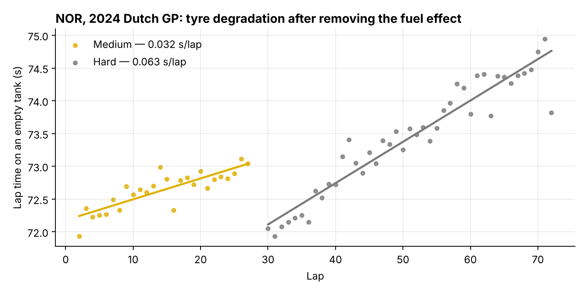
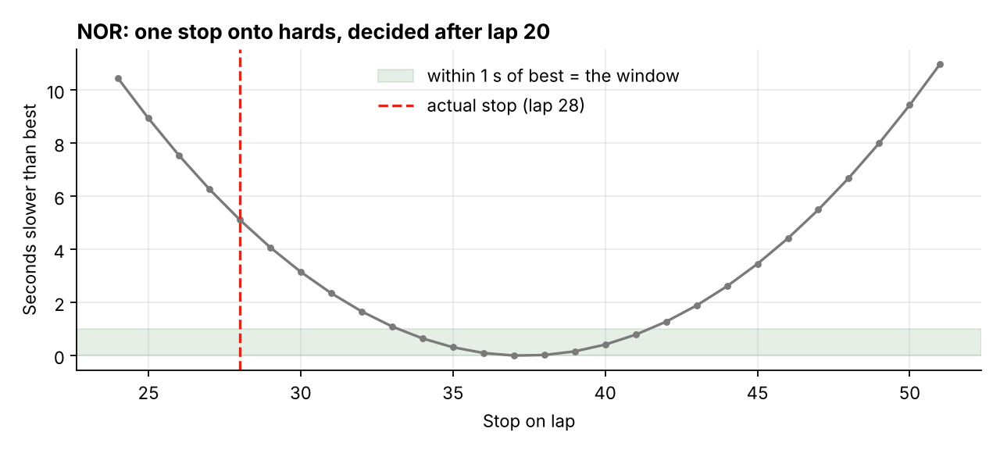
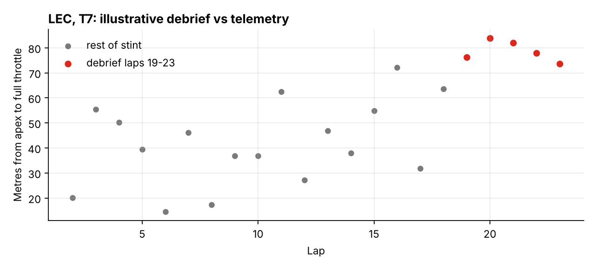

# Pit Wall

**A race-operations ontology with a human-approved strategy assistant, built on real Formula 1 timing and telemetry.**

Pit Wall models a race the way an operational platform models any complex operation: raw data becomes objects people reason about (cars, stints, laps, pit stops, driver debriefs), and decisions become *actions* that anyone, including an AI agent, can propose, but only a named human can approve. Every decision is logged.

As a racing driver, part of my job is turning what the car is doing into words an engineer can act on. This project also runs the other way: it takes those words and checks them against the telemetry.



## What it does

1. **Cleans the data and says why.** Laps behind the safety car, in-laps, out-laps, wet laps and traffic outliers are excluded from the tyre model, each with a stated reason.
2. **Measures tyre degradation.** Fuel burn makes a car faster every lap while tyre wear makes it slower. Pit Wall removes the fuel effect first, then fits a degradation rate per stint and per compound. At Zandvoort 2024, skipping that correction makes the mediums and hards look like they don't degrade at all (0.00 s/lap instead of ~0.06).
3. **Finds the pit window.** It evaluates every one-stop and two-stop plan from the current lap, enforces the two-compound rule, and handles a "safety car right now" case. It also reports the *break-even*: how much time you could lose in traffic before an extra stop stops paying.
4. **Checks driver debriefs against telemetry.** Write *"rear stepping out on exit of T7, can't get on the power, laps 19-23"*. Pit Wall parses the symptom, phase, corner and laps, then tests the right telemetry signal (here, distance from apex to full throttle) against the rest of the stint. The verdict is **supported**, **contradicted** or **inconclusive**.
5. **Includes a governed AI race engineer.** Claude answers questions using only the same tools the app uses, shows every tool call it made, and can *propose* a pit plan. It cannot approve one: the ontology rejects approvals from any `ai:` actor.

| Pit window | Debrief vs telemetry |
|---|---|
|  |  |

## Does the strategy model work? A backtest

For every car, the backtest goes back 8 laps before its first green-flag stop and rebuilds the tyre model **using only laps already driven by then**, so there's no peeking at the future. It then asks the model when to stop.

| Race | Cars | First stop called within ±3 laps | Mean error | Bias |
|---|---|---|---|---|
| 2026 British GP | 14 | **57%** | 3.0 laps | +0.7 laps |
| 2026 Dutch GP (mixed conditions) | 17 | 41% | 8.3 laps | +5.4 laps |
| 2024 Dutch GP | 20 | 10% | 11.1 laps | **+9.4 laps (too late)** |

At Zandvoort 2024 the model calls the stop about 9 laps later than the teams did. The tyre data alone says "stop at half distance", but on a track where overtaking is nearly impossible, teams stop early to protect track position and cover the undercut. The model has no idea that rivals exist. That gap is the most useful output here: it measures how much of a strategy call is tyres and how much is racing. Adding a rival-aware undercut model is the first item on the roadmap.

Run it yourself: `python -m pitwall --race data/races/2024_dutch_gp_race.csv backtest`

## Quick start

```bash
git clone https://github.com/<your-username>/pit-wall.git
cd pit-wall
python -m venv .venv && source .venv/bin/activate   # Windows: .venv\Scripts\activate
pip install -r requirements.txt

streamlit run app.py            # the app
python -m pytest                # 36 tests, ~6 seconds
```

Command line:

```bash
python -m pitwall summary
python -m pitwall stints NOR
python -m pitwall strategy NOR --after-lap 20
python -m pitwall strategy NOR --after-lap 20 --safety-car
python -m pitwall debriefs
python -m pitwall backtest
```

AI race engineer (optional; everything else works without it):

```bash
export ANTHROPIC_API_KEY=sk-ant-...        # Windows PowerShell: $env:ANTHROPIC_API_KEY="sk-ant-..."
python -m pitwall ask "When should Norris have stopped, and how close was the real stop?"
```

Add any other race:

```bash
python scripts/download_race.py --year 2026 --event "Austrian Grand Prix" --out data/races/2026_austrian_gp_race.csv
python scripts/build_corner_metrics.py --year 2024 --event "Dutch Grand Prix" --drivers NOR VER LEC PIA \
    --out data/telemetry/2024_dutch_gp_corner_metrics.csv
```

## How it's built

```
data (laps, telemetry) ─► cleaning ─► models (degradation, strategy, debrief evidence)
                                              │
                              ┌───────────────▼───────────────┐
                              │  Ontology                     │
                              │  Driver ─ Stint ─ Lap         │
                              │  PitStop · Debrief · Plan     │
                              │  Actions: set_pit_plan,       │
                              │           log_debrief         │
                              └──┬──────────┬──────────────┬──┘
                                 │          │              │
                              Streamlit    CLI     AI engineer (tools)
                                 └── propose ──► human approves ──► write-back + audit log
```

See [docs/ARCHITECTURE.md](docs/ARCHITECTURE.md) for the object model and the design decisions, and [docs/LEARNING_GUIDE.md](docs/LEARNING_GUIDE.md) for a module-by-module walkthrough.

```
pitwall/
  ontology.py     objects, links, actions, approval rules, audit log
  data.py         loading, lap cleaning, pit stops, pit-loss estimate
  degradation.py  fuel correction, per-stint fits, compound models
  strategy.py     race-time model, 1- and 2-stop search, pit window
  corners.py      telemetry -> per-corner metrics
  debrief.py      parse driver feedback, test it against the data
  backtest.py     no-lookahead evaluation against real decisions
  core.py         PitWall: builds the ontology, the single entry point
  engineer.py     Claude tool-use loop (propose-only)
app.py            Streamlit app
scripts/          data download and figure generation
tests/            unit, real-data, AI-loop (mocked) and app smoke tests
```

## Limitations

- **Linear tyre model.** It doesn't capture warm-up, graining or a sudden cliff. Cliffs are flagged but not modelled.
- **No rivals, no traffic.** See the backtest above. This is the biggest gap.
- **Coarse telemetry.** Public data is sampled at about 4 Hz, roughly every 17 m at 250 km/h, so brake and throttle points are only that precise. Lateral g is derived from GPS position, not measured.
- **Fuel effect is assumed** at 0.06 s per lap. It's a parameter, so its sensitivity can be tested.
- **The bundled debriefs are illustrative.** They were written for this demo to show supported, contradicted and inconclusive cases. They are not real team radio.

## Roadmap

- [ ] Undercut/overcut model using gaps to the cars around you, then re-run the backtest
- [ ] Traffic cost per stop, learned from position changes after real stops
- [ ] Adapter for my own sim-racing telemetry and debriefs, to test the debrief checker on laps I drove myself
- [ ] Four-eyes rule: the proposer can't approve their own plan

## How this was built

I designed the system and the domain model, and wrote the code with Claude as a pair programmer. I use [docs/LEARNING_GUIDE.md](docs/LEARNING_GUIDE.md) to make sure I can explain and extend every part of it.

## Data and licence

Timing and telemetry come from [TracingInsights](https://github.com/TracingInsights) (Apache-2.0), derived from F1 live timing via [FastF1](https://github.com/theOehrly/Fast-F1). This is an unofficial project, not associated with the Formula 1 companies; F1 and related marks are trademarks of Formula One Licensing B.V. See [NOTICE](NOTICE).

Code: [MIT](LICENSE).
