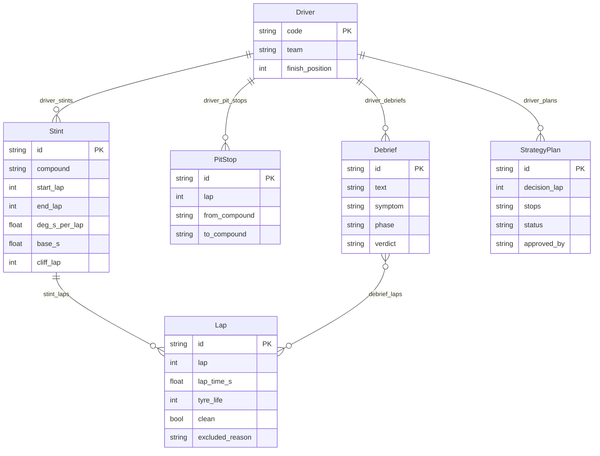
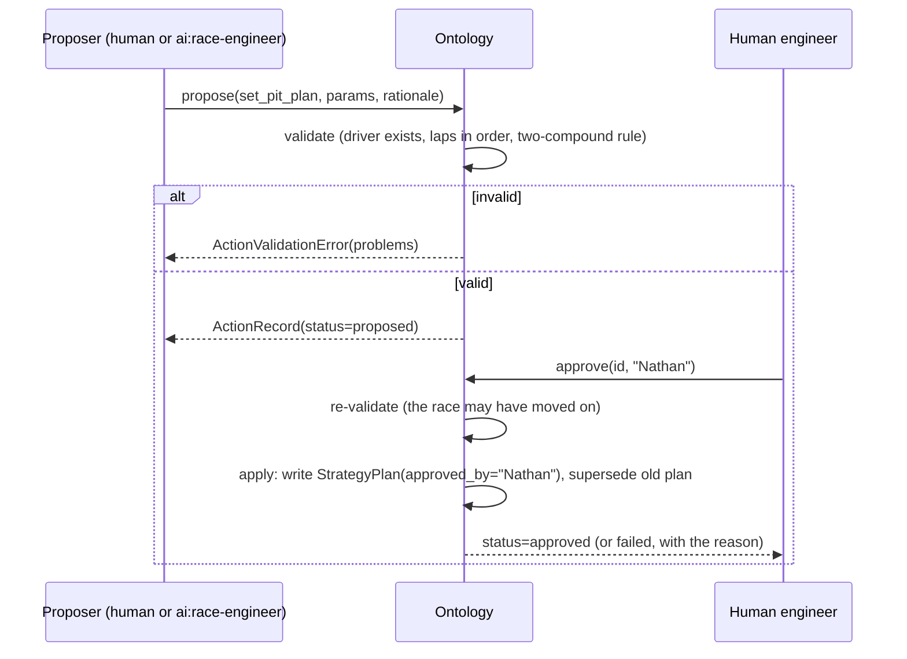

# Architecture

## The object model

Derived values live **on the objects** (a Stint carries its own degradation fit; a Lap carries why it was excluded; a Debrief carries its verdict). Anyone looking at an object sees the analysis next to the data, without rerunning anything.

## Actions and the approval loop

Rules enforced in `pitwall/ontology.py`:

| Rule | Why |
|---|---|
| Validation runs at proposal **and** at approval | State changes between the two; a valid plan at lap 20 may be invalid at lap 30 |
| Actors named `ai:*` can propose but never approve or reject | The agent's authority is limited by design, not by a prompt it could ignore |
| Rejections need a reason | The reason is training data for the next proposal, human or AI |
| The approver's name is written into the data | `StrategyPlan.approved_by` answers "who decided this?" without searching logs |
| Every proposal is kept, including rejected and failed ones | An audit log has to be complete to be trusted |

## Why the AI goes through tools

The race engineer (`pitwall/engineer.py`) never receives the raw tables. It gets six tools, each of which calls the same `PitWall` methods as the app and the CLI. This gives three properties:

1. **Same answer everywhere.** The AI can't compute a different pit window from the one the app shows.
2. **Traceable.** Each reply lists its tool calls with inputs, so a human can check the numbers behind a claim.
3. **Bounded.** The only write it can do is `propose_pit_plan`, which goes into the same approval queue as a human proposal.

Tool errors (an unknown driver, an invalid plan) go back to the model as `is_error` results rather than crashing, so it can correct itself.

## Design decisions and trade-offs

| Decision | Alternative | Why this one |
|---|---|---|
| Linear degradation per stint | Quadratic or piecewise models | Easy to explain and fit robustly on 10-40 laps; cliffs are flagged separately |
| Compound pace offsets compared *within* each driver | Raw medians across all cars | Car performance differences would otherwise swamp compound differences |
| Exhaustive search over stop laps | Optimiser / dynamic programming | 72 laps × 9 compound pairs is ~20k cases, under a second, and obviously correct |
| Closed-form stint time (arithmetic series) | Summing lap by lap | Same answer (a test checks this), and it keeps the 2-stop search instant |
| Welch t-statistic + minimum effect for debriefs | Fixed thresholds only | Corners differ in noise; the t-stat adapts to how noisy each corner is |
| Pit loss measured from the race | A fixed number per track | It's in the data; neutralised stops and outliers are filtered out |
| Backtest rebuilds models from past laps only | Score against the full-race model | Using future laps would make the model look better than it would have been live |
